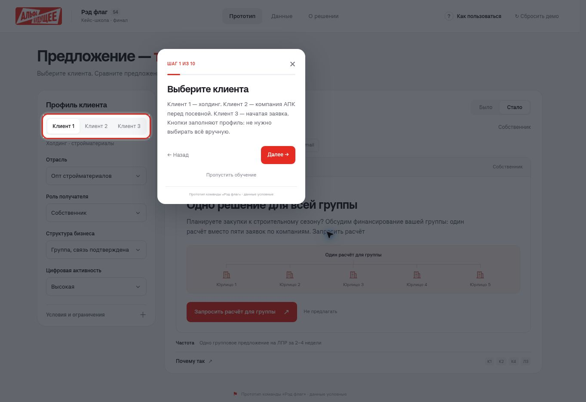

# Обучение по прототипу

Ветка: `feat/guided-tour`. Обучение объясняет работу стенда эксперту, отдельно от банковской помощи К5 клиенту в заявке.

При первом открытии появляется приглашение. Можно начать обучение или сразу закрыть его. После завершения либо пропуска приглашение больше не появляется в этом браузере. Кнопка **«Как пользоваться»** в шапке запускает его повторно. На телефоне кнопка выглядит как **?**.

## Маршрут

1. Три готовых клиента.
2. Четыре поля профиля и пересчёт предложения.
3. Передача интереса от операциониста руководителю.
4. Условное «Было» и персонализированное «Стало».
5. Каналы на примере Клиента 2.
6. Объяснение решения и коды правил.
7. Блокировка при двух контактах за неделю.
8. Сумма и срок в калькуляторе.
9. Помощь в начатой заявке Клиента 3.
10. Разделы с данными и логикой решения.

Подсветка следует за элементом при прокрутке и изменении размера окна. Во время обучения примерами управляют кнопки «Далее» и «Назад»; интерфейс под затемнением недоступен для случайных действий. Можно выйти крестиком, кнопкой пропуска или Esc. Стрелки клавиатуры переключают шаги, Tab остаётся внутри окна обучения.

Обучение временно показывает подготовленные примеры. При выходе возвращаются профиль, ограничения, выбранный раздел, раскрытые блоки, положение прокрутки и черновик. Учебные действия не записываются в бизнес-события и не расходуют однократную помощь К5. Реальные отправки отсутствуют.

## Устройство

- `tour.js`: тексты шагов, размещение окна и подсветки, управление модальным обучением, фокусом и отметкой первого посещения.
- `tour.css`: подсветка, затемнение, компактное окно, вёрстка для узких экранов.
- `app.js`: сохранение и восстановление состояния, подготовка примеров без записи событий.
- Отметка посещения хранится локально в `redflag-guided-tour-v1`. При недоступном хранилище обучение работает; после перезагрузки приглашение может появиться снова.

Проверки: `npm test`, `npm run check`, `node scripts/check-static.cjs`, `npm run build`. Геометрия покрыта 240 сочетаниями размеров и координат. В браузере пройдены desktop, 390 × 844 и 320 × 568, возврат назад, пропуск, Esc, повторный запуск, сохранение черновика и отсутствие учебных событий. Это проверка в браузере, не на физическом телефоне.

